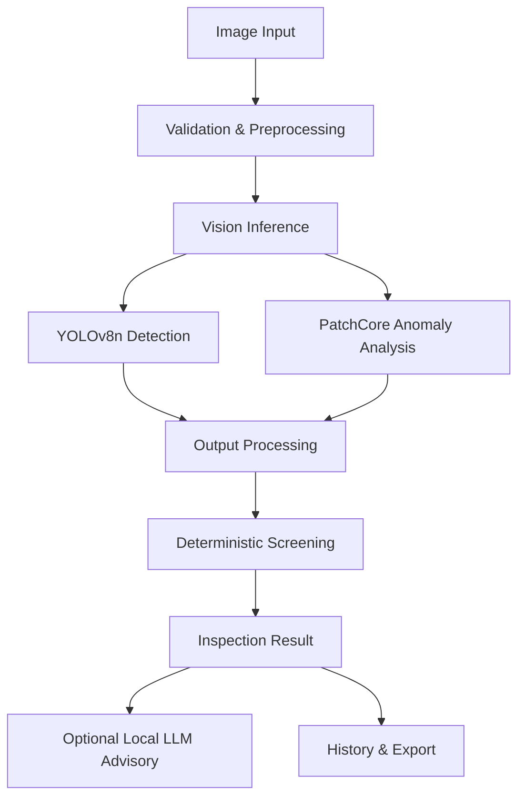
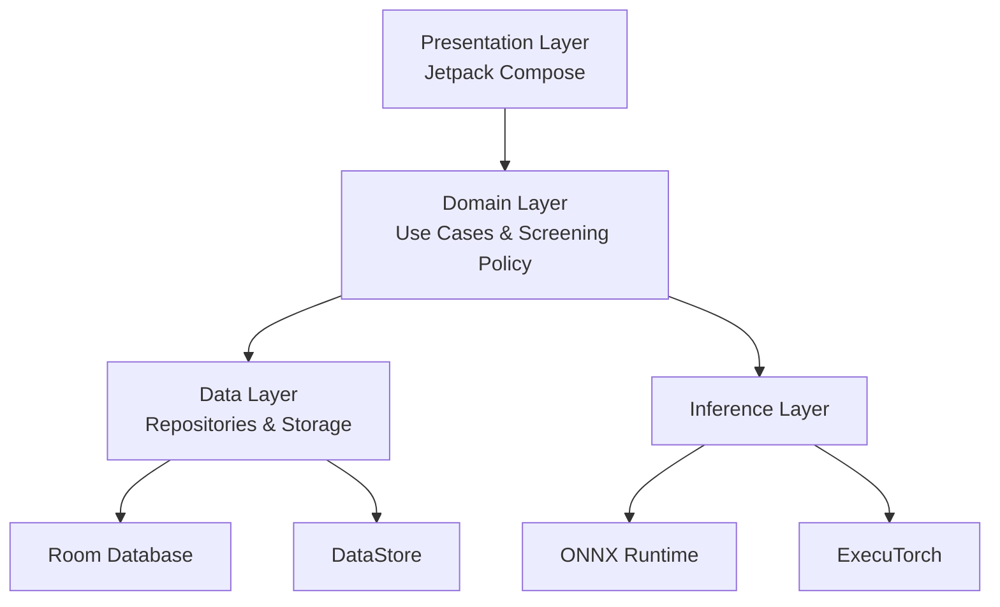

# Bharat AI PCB Inspector

**Offline-first, on-device AI for PCB defect detection and component anomaly inspection on Android.**

Bharat AI PCB Inspector is an Android application that combines computer vision, anomaly detection, and local language models to assist with PCB inspection and electronic component analysis.

Designed specifically for **ARM-based Android SoCs**, the application explores deploying multiple AI workloads directly on mobile hardware, enabling inspection and AI-assisted analysis without cloud inference or continuous internet connectivity.

**Offline-first · On-device AI · ARM Android · Computer Vision · Edge AI**

---

## Overview

Bharat AI PCB Inspector integrates multiple AI models with a deterministic screening pipeline to identify potential defects, analyze visual anomalies, and provide contextual technical insights.

### Features

- **PCB Defect Detection** — Detect and localize potential PCB defects using YOLOv8n.
- **Component Anomaly Detection** — Identify visual anomalies in electronic components using PatchCore.
- **AI Technical Advisory** — Generate contextual inspection explanations using a locally running LLM.
- **Inspection Results** — View detections, anomaly scores, annotated images, and screening outcomes.
- **Inspection History** — Store, search, filter, and revisit previous inspections.
- **CSV Export** — Export inspection findings for further analysis.
- **Offline-first Operation** — Perform AI inference locally without cloud APIs.
- **Model Management** — Import, validate, and manage model artifacts on-device.

---

## Screenshots

| Dashboard | Inspection |
|---|---|
|  |  |

| Results | AI Advisory |
|---|---|
|  |  |

| History | Settings |
|---|---|
|  |  |

---

## AI Models

| Model | Purpose | Runtime |
|---|---|---|
| YOLOv8n | PCB defect detection and localization | ONNX Runtime |
| PatchCore | Visual anomaly detection | ONNX Runtime |
| Llama 3.2 3B Instruct | AI-assisted technical advisory | ExecuTorch |

### Model Responsibilities

- **YOLOv8n:** Detects and localizes PCB defects.
- **PatchCore:** Identifies anomalous visual patterns in component images.
- **Llama 3.2 3B Instruct:** Generates contextual explanations and inspection-related technical advisory.

The LLM operates strictly as an advisory component. It does not modify model detections, defect classifications, confidence values, anomaly scores, or the final screening disposition.

Model artifacts are distributed separately from the APK.

---

## Inspection Pipeline



### Screening Outcomes

| Status | Description |
|---|---|
| **PASS** | No configured screening rule requires escalation. |
| **REVIEW** | Findings require further human assessment. |
| **REJECT** | A configured rejection condition has been triggered. |
| **INCOMPLETE** | Inspection could not be completed successfully. |

The deterministic screening policy evaluates inspection findings independently of the LLM. AI-generated advisory is explanatory and does not have decision-making authority.

---

## Architecture

The application follows a layered architecture separating presentation, business logic, data management, and inference.



### Technology Stack

| Category | Technology |
|---|---|
| Language | Kotlin |
| UI | Jetpack Compose, Material 3 |
| Architecture | MVVM, Clean Architecture principles |
| Navigation | Navigation Compose |
| Camera | CameraX |
| Database | Room |
| Preferences | DataStore |
| Computer Vision | ONNX Runtime |
| LLM Inference | ExecuTorch |
| Asynchronous Processing | Coroutines, Flow |
| Image Loading | Coil |
| Testing | JUnit, Robolectric, Compose UI Testing |

---

## On-device AI & Edge Computing

The project focuses on the practical deployment of AI models on resource-constrained Android hardware.

Key areas of exploration include:

- On-device inference on ARM-based Android SoCs.
- Offline AI execution without cloud dependencies.
- Coexistence of multiple AI models and runtimes.
- Memory utilization and resource management.
- Inference latency and throughput characterization.
- Practical constraints of mobile Edge AI deployment.

---

## Performance Overview

Initial benchmarks were conducted on a physical Android device.

| Model | Average Pipeline Latency |
|---|---:|
| YOLOv8n | 324.8 ms |
| PatchCore | 3,664.2 ms |

These measurements represent application-level pipeline timings and not necessarily pure model execution time. Performance varies with hardware, memory availability, thermal conditions, and runtime state.

Detailed benchmarking methodology, LLM generation performance, memory observations, and analysis are documented separately.

**[View Benchmark Report](benchmark.md)**

---

## Repository Structure

```text
android/
├── app/
│   ├── src/main/java/com/example/
│   │   ├── app/
│   │   ├── data/
│   │   ├── domain/
│   │   ├── inference/
│   │   ├── navigation/
│   │   ├── presentation/
│   │   ├── storage/
│   │   └── imageprocessing/
│   └── libs/
├── gradle/
├── screenshots/
├── benchmark.md
└── README.md
```

---

## Download & Installation

### Android APK

**Latest Release: [v0.1.0](https://github.com/radicalSanta/Bharat-AI-PCB-Inspector/releases/tag/v0.1.0)**

- [Download APK](https://github.com/radicalSanta/Bharat-AI-PCB-Inspector/releases/download/v0.1.0/app-release.apk)
- [SHA-256 Checksums](https://github.com/radicalSanta/Bharat-AI-PCB-Inspector/releases/download/v0.1.0/SHA256SUMS.txt)

### Model Assets

Model files are distributed separately from the APK.

**[Download Model Assets](https://drive.google.com/drive/folders/1Lveex3x1ncNOlms8069mATbmIOqra51r?usp=drive_link)**

Download and import the required model artifacts through the application's model management interface.

> The corresponding inspection or advisory functionality requires its model artifacts to be installed and validated.

---

## Build from Source

### Prerequisites

- Android Studio
- Android SDK
- Compatible JDK
- Android device or emulator

### Clone

```bash
git clone https://github.com/radicalSanta/Bharat-AI-PCB-Inspector.git
cd Bharat-AI-PCB-Inspector/android
```

### Build Debug APK

```bash
./gradlew assembleDebug
```

APK output:

```text
app/build/outputs/apk/debug/app-debug.apk
```

### Run Tests

Unit tests:

```bash
./gradlew testDebugUnitTest
```

Instrumentation tests:

```bash
./gradlew connectedDebugAndroidTest
```

---

## Limitations

Bharat AI PCB Inspector is an image-based inspection prototype, not a replacement for professional PCB testing or manufacturing quality assurance.

- Inspection is limited to defects and anomalies detectable from supplied images.
- It cannot verify electrical continuity, circuit functionality, or defects hidden within internal PCB layers.
- Image quality, lighting, orientation, and resolution affect detection performance.
- AI models may produce false positives and false negatives.
- PatchCore anomaly scores are not calibrated probabilities of component failure.
- PASS does not certify that a PCB is defect-free or compliant with manufacturing standards.

Inspection results should be treated as screening assistance and verified through appropriate engineering inspection and testing.

---

## Project Status

**Current Release: v0.1.0**

The project is an ongoing exploration of mobile computer vision, offline-first AI, and Edge AI deployment on Android devices.

### Future Work

- Improve inference performance and model efficiency.
- Optimize memory consumption during multi-model execution.
- Explore hardware acceleration on supported Android SoCs.
- Improve image preprocessing and inspection reliability.
- Expand defect coverage and validation datasets.
- Optimize local LLM generation and resource utilization.

---

## License

Licensing for application source code, model weights, datasets, and third-party dependencies must be considered separately. Refer to their respective licenses before redistribution or commercial use.

---

## Disclaimer

This project is intended for experimental, educational, and engineering research purposes. AI-generated findings and screening outcomes are not guaranteed to be accurate. The application does not replace professional inspection, electrical testing, or certified manufacturing quality-control processes.
