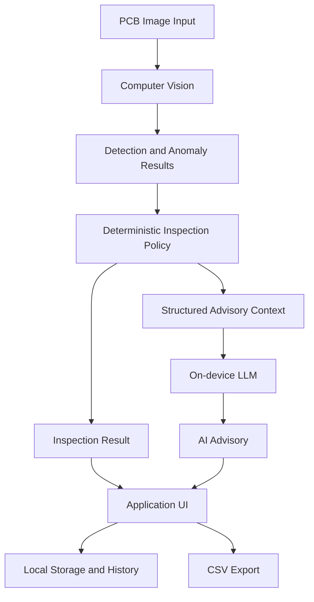
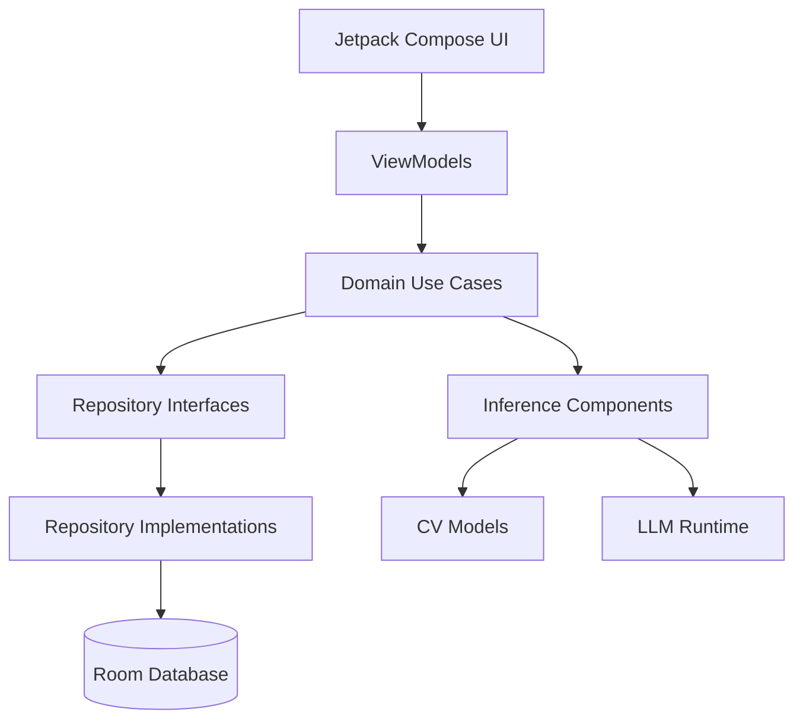

# Bharat AI PCB Inspector

An Android application for AI-assisted PCB inspection. It combines computer-vision inference with deterministic inspection rules and a locally running language model that provides engineering advisory context.


## Features

- Capture or select PCB images for inspection.
- Detect and localize potential PCB defects.
- Combine CV outputs with a deterministic inspection policy.
- Display inspection disposition and defect details.
- Generate an on-device AI advisory for probable root causes and recommended operator actions.
- Store inspection records locally and review inspection history.
- Export inspection data as CSV.
- Manage/import model assets separately from the APK.


## System Overview



The CV pipeline uses YOLO-based detection and PatchCore-based anomaly detection. Detailed model architecture, preprocessing, inference, and evaluation are covered in the CV/ML documentation.


## Android Application

The Android application is organized around separation of UI, domain logic, data access, and inference components. The UI presents inspection controls and results, while domain/use-case logic coordinates inspection and policy evaluation. Repository implementations provide persistence and data operations.



### Application responsibilities

- **Image input and validation:** accepts image input and prepares it for processing.
- **Inspection orchestration:** runs the inspection pipeline and coordinates results.
- **Policy evaluation:** applies deterministic screening logic to CV findings to determine the inspection disposition.
- **Result presentation:** displays the disposition, defect information, and advisory content.
- **Persistence:** stores inspection data for history and dashboard views.
- **Export:** writes inspection records to CSV.
- **Model management:** handles model assets and their lifecycle independently from ordinary application data.


## Computer Vision

The CV pipeline combines YOLO-based defect detection and PatchCore anomaly detection. Its outputs are processed by the deterministic inspection policy.

See the CV/ML README for model-specific details.


## On-device LLM Advisory

### Model

| Component | Configuration |
|---|---|
| Model | Llama 3.2 3B Instruct |
| Runtime | ExecuTorch 1.6.0 |
| Backend | XNNPACK |
| Execution | CPU |
| Quantization | SpinQuant |
| Artifact | `.pte` |
| KV cache | Enabled |


The LLM operates as an advisory layer on inspection data already produced by the CV pipeline and deterministic policy. It is used to generate contextual explanations such as:

- Probable root cause
- Recommended operator action
- Relevant standards context
- Limitations and scope

The LLM **does not detect defects, modify defect classes or confidence scores, change bounding boxes, or override the inspection disposition**. The CV pipeline and deterministic policy remain authoritative for inspection outcomes.

### Model assets

The local model package consists of:

- `model.pte` — compiled ExecuTorch model artifact
- `tokenizer.json` — tokenizer data
- `config.json` — model configuration

The model is approximately 2.22 GiB and is not bundled into the standard APK. Model assets are imported/managed separately on the device. The import lifecycle includes integrity checks and safeguards for incomplete or failed imports.


## Data Storage and CSV Logging

Inspection records are stored locally using Room. CSV logging/export provides a portable record of inspection metadata, dispositions, defect details, advisory information, and timing data.

The inspection CSV is defect-entry oriented: multiple rows can share an `inspection_id`. An inspection with zero defects may not produce a defect row. Row counts therefore should not be treated as inspection counts.


## Project Structure

```text
BharatPCB2/
└── android/
    ├── app/
    │   ├── src/
    │   │   ├── main/
    │   │   ├── test/
    │   │   └── androidTest/
    │   ├── libs/
    │   └── build.gradle.kts
    ├── gradle/
    ├── gradlew
    ├── build.gradle.kts
    └── settings.gradle.kts
```


## Build and Test

Requirements:

- Android Studio or Android SDK command-line tools
- JDK compatible with the project's Gradle configuration
- Android SDK configured locally

From the Android project directory:

```bash
cd android
./gradlew assembleDebug
```

Run unit tests:

```bash
./gradlew testDebugUnitTest
```

The Android SDK path is configured locally through `local.properties`; do not commit that file.


## Model Assets

Model assets are distributed separately from the APK due to their size. Download the required assets from the project's model-assets location and follow the in-app import flow.


## Performance and Limitations

On-device inference is CPU-based, so performance varies with device hardware, memory availability, thermal conditions, and model generation settings. LLM advisory generation can take considerably longer than CV inference.

Inspection results and generated advisory text should be treated as decision-support information and verified by a qualified operator. The application is not a substitute for electrical testing or established PCB quality-control procedures.

Performance figures in inspection logs are observational and are not controlled benchmark results.


## Documentation

- CV/ML documentation: model design, preprocessing, inference, and evaluation details.
- LLM implementation documentation: model preparation, runtime integration, artifact validation, generation, and known performance issues.
