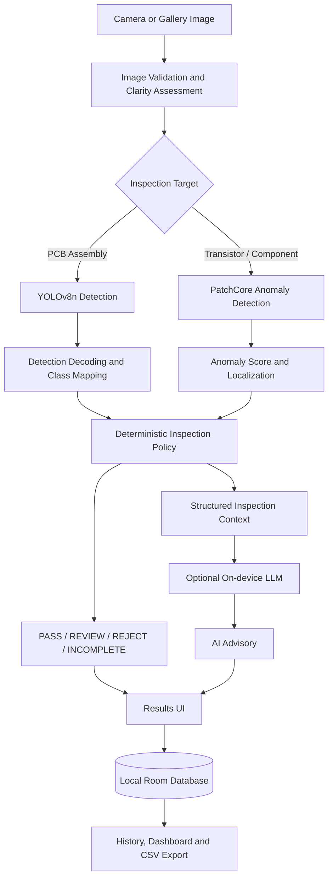
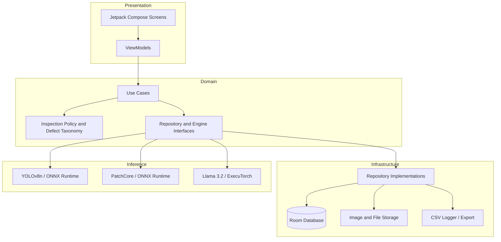

# Bharat AI PCB Inspector

**On-device optical inspection for PCB assemblies and transistor components.**

Bharat AI PCB Inspector is an Android application that combines computer vision, deterministic screening logic, and an optional on-device language model to assist with visual PCB inspection. It is designed around a strict separation of responsibilities: computer-vision models produce findings, a deterministic policy evaluates those findings, and the language model provides explanatory advisory context.

> **Scope:** This application performs optical, image-based screening. It does not perform electrical testing, certify manufacturing quality, or replace qualified operator review and established quality-control procedures. Its PASS / REVIEW / REJECT outputs are screening dispositions under the configured policy—not declarations of IPC compliance.

---

## Screenshots

<!-- Add app screenshots to the repository under docs/images/ and update these paths. -->
| Dashboard | Inspection setup |
|:---:|:---:|
|  |  |

| Inspection results | AI advisory |
|:---:|:---:|
|  |  |

| Inspection history | Model settings |
|:---:|:---:|
|  |  |

---

## What it does

- Captures PCB images with the device camera or imports images from the gallery.
- Validates image dimensions and assesses image clarity before inference.
- Detects and localizes PCB defect candidates using a YOLOv8n-based model.
- Screens transistor/component images for visual anomalies using a PatchCore-based model.
- Applies a configurable, deterministic policy to computer-vision findings and produces a screening disposition.
- Optionally generates a local AI advisory with probable root-cause context, recommended operator action, and relevant standards context.
- Stores inspection records locally, including findings, policy configuration, model provenance, and timing metrics.
- Provides a dashboard, inspection history, result details, and CSV export.
- Manages model artifacts separately from the application package, with validation and lifecycle controls.

## Inspection pipeline

The application intentionally keeps model inference separate from inspection decision-making.



### 1. Image validation

Images are checked for validity and processability before model execution. The application records image dimensions and a clarity assessment. A low-clarity image can trigger a REVIEW outcome; zero localized defects on a poor-quality frame are not automatically treated as a clean PASS.

### 2. PCB defect detection — YOLOv8n

For PCB-board inspection, the application uses an ONNX Runtime-based YOLOv8n detection pipeline. The pipeline includes image preprocessing, model execution, output decoding, non-maximum suppression, and mapping model labels to the application's canonical defect taxonomy.

The current taxonomy contains these dataset labels:

| Label | Canonical interpretation |
|---|---|
| `open` | Open Circuit |
| `short` | Short Circuit |
| `mouse_bite` | Mouse Bite |
| `spur` | Spur |
| `spurious_copper` | Spurious Copper |
| `missing_copper` | Missing Copper |
| `copper_burr` | Copper Burr |
| `pin_hole` | Pin Hole |
| `hole_breakout` | Hole Breakout |
| `scratch` | Scratch |
| `copper` | Copper — requires dataset-definition verification |

The model's raw label is not used as an unqualified quality verdict. Class mapping and severity handling are centralized in the domain taxonomy. Unknown labels are preserved and escalated for manual review rather than silently remapped.

### 3. Transistor/component anomaly screening — PatchCore

A separate PatchCore pipeline is used for transistor/component inspection. It evaluates visual deviation from the model's learned reference distribution and can report an anomaly score and affected image region.

The normalized score shown for display is a heuristic transformation; it must **not** be interpreted as a calibrated probability of failure. An anomaly indication is a prompt for operator review, not proof of electrical malfunction.

### 4. Deterministic inspection policy

The policy engine evaluates the CV findings, image-quality assessment, and active policy configuration. It produces one of the following outcomes:

| Disposition | Meaning |
|---|---|
| **PASS** | No active screening rule requires escalation for the supplied image and findings. |
| **REVIEW** | The image or findings require human assessment. |
| **REJECT** | A configured rejection condition was triggered by the screening policy. |
| **INCOMPLETE** | A valid inspection result could not be completed. |

Policy settings include critical-, medium-, and low-severity handling, image-quality safeguards, minimum image dimensions, and a versioned configuration snapshot. Each inspection record retains its policy rationale and effective threshold summary.

The repository labels its default policy as an **IPC-A-610 Class 2 baseline screening profile**. This wording describes the configured reference profile only; it does not mean the application has been independently validated or certified against IPC-A-610 acceptance criteria. Defect severities and thresholds remain provisional screening logic and require verification against the applicable standard, product class, and manufacturing process.

### 5. Optional on-device AI advisory

The local language model receives structured inspection context after the CV and deterministic policy stages. It can provide:

- Probable root-cause context.
- Suggested operator action.
- Relevant standards context.
- Limitations and scope of the generated explanation.

The LLM is an **advisory component only**. It does not detect defects, alter bounding boxes or model confidence values, remap defect classes, or override the deterministic inspection disposition. The core inspection pipeline remains independent of advisory generation.

Current advisory model configuration:

| Component | Configuration |
|---|---|
| Model | Llama 3.2 3B Instruct |
| Runtime | ExecuTorch 1.6.0 |
| Execution backend | XNNPACK |
| Device execution | CPU |
| Quantization | SpinQuant |
| Model artifact | `.pte` |
| KV cache | Enabled |

The advisory model package includes a compiled model artifact, tokenizer data, and model configuration. Its approximate size is **2.22 GiB**, so it is distributed separately from the APK and imported through the application's model-management flow. Advisory generation is optional and may take substantially longer than computer-vision inference.

---

## Application features

### Dashboard
The dashboard summarizes stored inspection activity, including disposition counts, outcome trends, recent inspections, and model readiness.

### Inspection
Start an inspection from a camera capture or gallery image, choose the inspection target, and view the progress of the processing stages. Sample scenarios are available for demonstration; sample/demo results are marked and should not be treated as production model inference.

### Results and advisory
Review the inspection disposition, policy rationale, defect labels, confidence values, localized regions where available, image-quality information, inference timings, and model provenance. The advisory view presents the optional language-model explanation separately from the authoritative screening result.

### History and local records
Inspection records are stored on-device using Room. Records retain the image reference, timestamp, inspection target, disposition, defects/anomaly data, policy snapshot, model execution provenance, advisory status, and latency measurements.

### CSV export
The application supports CSV logging and export of inspection data. The export is defect-entry oriented: multiple rows can share an `inspection_id`. An inspection with no detected defects may not produce a defect row, so CSV row counts must not be interpreted as inspection counts.

### Model management
Model assets are managed independently from ordinary application data. The application exposes model readiness and supports artifact import/validation for the detection, transistor anomaly, and advisory model slots. A complete real-world inspection requires the relevant production model to be configured and ready. The demonstration/sample path is separate from production inference.

---

## Architecture

The Android application uses a layered structure that separates presentation, domain logic, data access, and inference.



### Technology stack

| Area | Technology |
|---|---|
| Language | Kotlin |
| UI | Jetpack Compose, Material 3 |
| Architecture | ViewModels, domain use cases, repository interfaces |
| Asynchronous work | Kotlin Coroutines and Flow |
| Navigation | Navigation Compose |
| Image capture | CameraX |
| Image loading | Coil |
| Local database | Room |
| Preferences | DataStore |
| PCB detection | YOLOv8n with ONNX Runtime |
| Component anomaly detection | PatchCore with ONNX Runtime |
| Local language model | Llama 3.2 3B Instruct with ExecuTorch |
| CSV | Local CSV logging and export |
| Tests | JUnit, Robolectric, Compose UI tests, Android instrumentation tests |

---

## Repository layout

```text
.
├── android/
│   ├── app/
│   │   ├── src/
│   │   │   ├── main/java/com/example/
│   │   │   │   ├── app/             # Application container and startup
│   │   │   │   ├── data/            # Room, repositories, preferences, CSV
│   │   │   │   ├── domain/          # Models, policies, interfaces, use cases
│   │   │   │   ├── inference/       # YOLO, PatchCore, ExecuTorch, model manager
│   │   │   │   ├── navigation/      # App navigation
│   │   │   │   ├── presentation/   # Compose screens, components, ViewModels
│   │   │   │   ├── storage/         # Image and file storage
│   │   │   │   └── imageprocessing/ # Safe image decoding
│   │   │   ├── test/                # JVM/unit and UI-related tests
│   │   │   └── androidTest/         # Device/instrumentation tests
│   │   ├── libs/                    # Local ExecuTorch AAR dependency
│   │   └── build.gradle.kts
│   ├── gradle/
│   ├── gradlew
│   └── settings.gradle.kts
└── README.md
```

---

## Download and install

The latest published release is **[v0.1.0](https://github.com/radicalSanta/Bharat-AI-PCB-Inspector/releases/tag/v0.1.0)**.

1. Download `app-release.apk` from the [GitHub Releases page](https://github.com/radicalSanta/Bharat-AI-PCB-Inspector/releases).
2. Verify the APK checksum using the accompanying `SHA256SUMS.txt`.
3. Install the APK on a compatible Android device. Android may ask you to allow installation from the source used to download the file.
4. Download the required model artifacts from the [model-assets folder](https://drive.google.com/drive/folders/1Lveex3x1ncNOlms8069mATbmIOqra51r?usp=drive_link).
5. Use the in-app model-management screen to import the artifacts required for the inspection target and advisory features you intend to use.

The v0.1.0 release APK is approximately **117.9 MB**. Model files are distributed separately to keep the APK smaller. The advisory model is optional; the detection/anomaly model corresponding to the selected inspection target is required for production inference.

### Release artifacts

| Artifact | Description |
|---|---|
| [app-release.apk](https://github.com/radicalSanta/Bharat-AI-PCB-Inspector/releases/download/v0.1.0/app-release.apk) | Android release APK |
| [SHA256SUMS.txt](https://github.com/radicalSanta/Bharat-AI-PCB-Inspector/releases/download/v0.1.0/SHA256SUMS.txt) | SHA-256 checksums for release artifacts |
| [Model assets](https://drive.google.com/drive/folders/1Lveex3x1ncNOlms8069mATbmIOqra51r?usp=drive_link) | Separately distributed inference models and supporting files |

---

## Build from source

### Prerequisites

- Android Studio or Android SDK command-line tools.
- A JDK compatible with the Gradle/Android Gradle Plugin versions configured by this project.
- Android SDK Platform and Build Tools matching the project's compile SDK configuration.
- The ExecuTorch AAR dependency at `android/app/libs/executorch.aar`.

The repository currently includes the ExecuTorch AAR under `android/app/libs/`. The Gradle build script also contains a developer-machine-specific fallback path for that AAR; contributors should ensure the repository-local AAR is present rather than relying on that fallback.

### Build a debug APK

```bash
git clone https://github.com/radicalSanta/Bharat-AI-PCB-Inspector.git
cd Bharat-AI-PCB-Inspector/android

# Build
./gradlew assembleDebug
```

The debug APK is generated under:

```text
android/app/build/outputs/apk/debug/
```

### Run unit tests

```bash
cd android
./gradlew testDebugUnitTest
```

### Run instrumentation tests

Connect a compatible Android device or start an emulator, then run:

```bash
./gradlew connectedDebugAndroidTest
```

Android Studio may create a local `local.properties` file to store the Android SDK path. Do not commit machine-specific SDK paths or secrets.

---

## Model assets

The models are not all bundled into the APK. Download them from the [model-assets folder](https://drive.google.com/drive/folders/1Lveex3x1ncNOlms8069mATbmIOqra51r?usp=drive_link), then import them using the app's model-management flow.

| Model slot | Role | Runtime |
|---|---|---|
| PCB detection | Localizes PCB defect candidates | ONNX Runtime |
| Transistor anomaly | Visual anomaly screening for transistor/component images | ONNX Runtime |
| AI advisory | Generates explanatory advisory from structured inspection context | ExecuTorch |

Use the model package and tokenizer/configuration files intended to work together. Do not rename or mix files from different model exports unless the model packaging instructions explicitly allow it. The application validates imported artifacts, but a successful file import should not be interpreted as evidence that the model is scientifically accurate for a particular production line or defect distribution.

---

## Testing and validation

The repository includes tests for important parts of the application, including:

- Inspection policy and defect taxonomy.
- Inspection orchestration and domain integration.
- YOLO preprocessing, output decoding, and detection pipeline behavior.
- PatchCore contract, preprocessing, output decoding, and inference behavior.
- Model import and model lifecycle handling.
- Advisory prompt construction, output parsing, generation budgeting, tokenizer behavior, and ExecuTorch integration.
- Image decoding and validation.
- ViewModels and Compose UI behavior.
- Device-side advisory inference.

Passing software tests verifies the tested implementation paths; it does not establish model accuracy, industrial suitability, or standards compliance. Those require representative datasets, independent evaluation, and controlled device/production-line validation.

---

## Performance considerations

Inference is performed locally and is affected by device CPU performance, available memory, storage speed, thermal state, image dimensions, model configuration, and concurrent workloads. LLM generation can have significantly higher latency and memory cost than CV inference.

The application records stage-level timing information where available. These are per-inspection observations, not controlled benchmark results. Performance comparisons should use a documented test dataset, warm-up runs, repeated measurements, and consistent device/thermal conditions.

---

## Limitations and responsible use

- The system analyzes images; it does not measure electrical continuity, resistance, impedance, signal integrity, or circuit behavior.
- Optical findings depend on image quality, lighting, focus, viewpoint, board geometry, and the model's training distribution.
- A detector's confidence score is not the probability that a board is defective.
- A PatchCore display score is not a calibrated probability of failure.
- Defect classes and severity rules are tied to the configured dataset taxonomy and provisional screening policy.
- An IPC-A-610 reference profile in the app is not proof of certification, compliance, or standards validation.
- The LLM can generate incorrect or incomplete explanations. Treat its output as advisory and verify it independently.
- Sample/demo inspections are simulations or preset scenarios and must not be mixed with production inference results.
- Final disposition and acceptance decisions should be made under the organization's validated inspection procedure by qualified personnel.

---

## License and third-party components

A repository license and third-party model/runtime license inventory should be consulted before redistribution or commercial deployment. In particular, review the licenses and usage terms for the model weights, ExecuTorch, ONNX Runtime, and any other bundled native/runtime components. Do not assume that a model's code license also grants unrestricted rights to its weights or training data.

---

## Contributing

Contributions are welcome. Before submitting a change:

1. Describe the problem and the proposed change.
2. Keep model inference, deterministic policy, data persistence, and UI responsibilities separated.
3. Add or update tests for modified behavior—especially policy boundaries, model contracts, malformed outputs, and failure paths.
4. Run the relevant Gradle test tasks and build the app locally.
5. Include device-level validation details for changes affecting camera, native runtimes, model loading, memory, or inference.

When reporting model or inference issues, include the device model, Android version, model artifact/version, inspection target, image dimensions, and relevant logs. Do not attach private production PCB images or secrets to public issues.

---

## Project status

The repository currently publishes the **v0.1.0** Android release. Treat this as an early release: model accuracy, supported hardware, and production suitability should be established through further documented evaluation.
